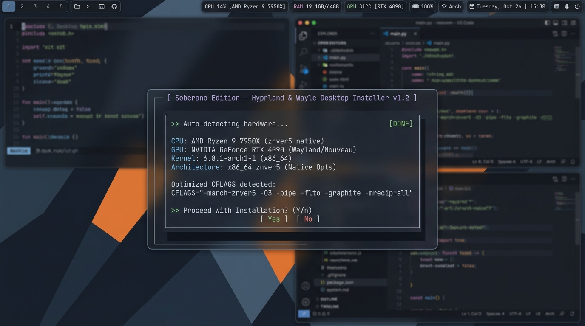
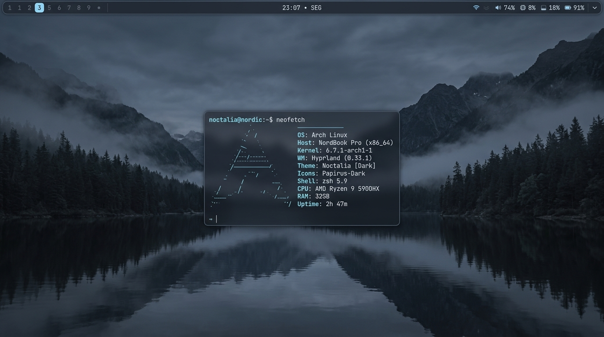
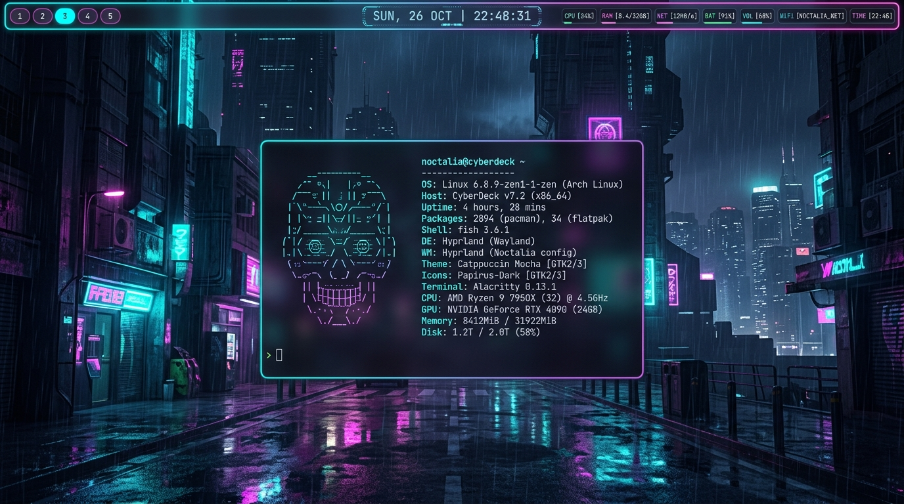
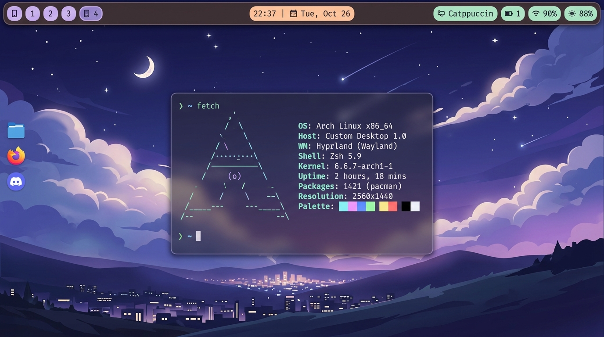
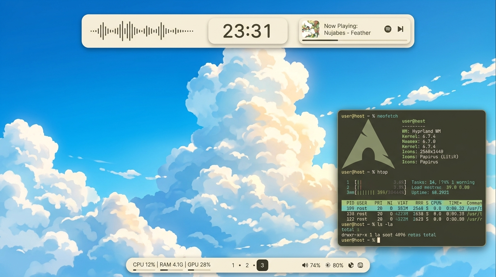

# Soberano Dotfiles

<p align="center">
  
</p>

Arquitetura enxuta, modular e de altíssimo desempenho para **Arch Linux** e **CachyOS**, construída do zero sobre **Hyprland (Lua Nativo)**, **Wayle Shell (`wayle-bin` em Rust/GTK4)**, **Matugen (Material Design 3)**, **Fuzzel** e **awww**.

---

## Galeria Visual & Presets

O Soberano Dotfiles foi desenvolvido com um motor de temas responsivo integrado ao Material Design 3. Ao trocar o papel de parede, todos os componentes do sistema (Barra Wayle, Hyprland, Kitty, Fuzzel, Btop e GTK) se adaptam harmonicamente em milissegundos.

| Nordic Slate (Foco & Código) | Cyberpunk Glow (Shaders & CAVA) |
| :---: | :---: |
|  |  |

| Catppuccin Velvet (Pastel Suave) | Japanese Minimalist (Estética Clean) |
| :---: | :---: |
|  |  |

> [!TIP]
> **Todos os temas acima vêm 100% integrados e prontos para uso no repositório!**
> Você pode alternar entre eles a qualquer momento pressionando **`Super + Shift + T`** ou rodando **`soberano-theme`** no terminal. O script aplica instantaneamente o papel de parede correspondente da coleção em `wallpapers/`, a geometria da barra do Wayle, o algoritmo de cores do Matugen e os shaders GLSL correspondentes.

---

## Destaques da Arquitetura

- **Instalador TUI Inteligente (Inspirado no Gentoo)**: Interface via `dialog` com alto contraste, autodetecção de hardware e validação sem quebras visuais.
- **Auto-Detecção de Hardware & Microarquitetura**:
  - Detecção precisa de GPUs (NVIDIA Híbrido, AMD Radeon iGPU/dGPU, Intel Iris/Xe, ou Máquinas Virtuais).
  - Leitura do ISA real da CPU (ex: `znver5`, `znver4`, `alderlake`, `skylake`) e extensões vetoriais (`AVX-512`, `AVX2`, `FMA`, `AES`, `SHA`).
  - Calibragem automática de `CFLAGS="-march=native -O3 -pipe -fno-plt"` e `MAKEFLAGS="-j$CORES"` em `/etc/makepkg.conf.d/` para que pacotes do AUR compilem com máxima performance de hardware.
  - Reconhecimento de chassi para ativação de gestos de touchpad em notebooks (`workspace_swipe`).
- **Sincronização Contínua & Auto-Atualização Git**:
  - Serviço e timer systemd (`soberano-autoupdate.timer`) para verificar e atualizar os dotfiles em segundo plano sem quebrar configs locais.
  - Notificações de desktop nativas (`notify-send`) informando novas revisões aplicadas.
  - Comando direto `soberano-update` no terminal.
- **Wayle Desktop Shell (Rust)**:
  - 10 presets visuais de barra alternáveis instantaneamente via `Super + Ctrl + B` (Floating Pill, Cyber Blade, Dynamic Island, macOS Dock, Audiophile Soundstage, etc.).
- **Material You Engine (Matugen)**:
  - Extração harmônica de cores em tempo real via algoritmo Material Design 3 (`Super + Alt + B`).
- **Shaders GLSL Hyprland**:
  - Filtros visuais de pós-processamento aplicados em tempo real na GPU (`Super + Alt + S`).

---

## Stack de Componentes

| Componente | Binário | Função Principal |
| :--- | :--- | :--- |
| **Compositor** | `Hyprland` (`hyprland.lua`) | Gerenciador de janelas Wayland configurado 100% em Lua nativo (`144Hz`, VRR, Direct Scanout) |
| **Desktop Shell** | `wayle` (`wayle-bin`) | Barra, Central de Notificações, OSD, CAVA, Áudio, Rede, Clima e Integração Nativa Matugen |
| **Motor de Cores** | `matugen` (`matugen-bin`) | Harmonização Material Design 3 sincronizando Wayle, Hyprland, Kitty, Fuzzel, Btop e GTK3/4 |
| **App Launcher** | `fuzzel` | Launcher Wayland ultraleve em C estilizado dinamicamente pelo Matugen |
| **Wallpaper Engine** | `awww` (`awww-daemon`) | Transições fluidas a 144 FPS controladas diretamente pelo Wayle (~2.7 MB RAM) |
| **Terminal & Monitor** | `kitty` + `btop` | Sincronizados em tempo real via templates Matugen |
| **Auto-Updater** | `soberano-update` | Sincronizador contínuo com repositório remoto via git e systemd timer |

---

## Como Instalar

### 1. Clonar o Repositório

```bash
git clone https://github.com/ViniciusPHDU20/soberano-dotfiles.git ~/dotfiles
cd ~/dotfiles
```

### 2. Modo de Simulação / Teste (Dry-Run Seguro)
Para testar a interface TUI, visualizar a detecção de hardware da sua máquina e conferir o relatório sem alterar nenhum pacote ou arquivo:

```bash
./install.sh --test
```

### 3. Instalação Definitiva
Para aplicar a instalação completa, configurar os drivers de vídeo e iniciar o ambiente:

```bash
./install.sh
```

---

## Atualizações Automáticas (Clientes)

O instalador configura opcionalmente o **Soberano Auto-Updater**, mantendo a máquina do cliente sempre sincronizada com as novidades do repositório:

- **Automático via Systemd**: o timer `soberano-autoupdate.timer` executa a sincronização periódica silenciosamente. Quando você envia um commit no GitHub, a máquina do cliente baixa as novidades, recarrega o Hyprland ao vivo e envia uma notificação visual.
- **Manual via Terminal**: a qualquer momento, o usuário pode rodar:
  ```bash
  soberano-update
  ```

---

## Atalhos de Teclado Principais

| Atalho | Ação |
| :--- | :--- |
| `Super + Q` | Abrir Terminal Kitty |
| `Super + Espaço` / `Super + D` | Lançador de Aplicativos (Fuzzel) |
| `Super + W` | Galeria de Wallpapers GTK4 (Cinema Studio) |
| `Super + Alt + W` | Wallpaper Aleatório com Transição + Matugen |
| `Super + Shift + T` | Seletor de Temas Oficiais (Nordic, Cyberpunk, Catppuccin, Zen) |
| `Super + Ctrl + B` | Seletor de Presets da Barra Wayle (10 layouts) |
| `Super + Alt + B` | Seletor de Esquemas de Cores Material You |
| `Super + Alt + S` | Alternar Shaders GLSL de Tela (Cyberpunk, CRT, etc.) |
| `Super + Alt + A` | Seletor de Perfis de Animação do Hyprland |
| `Super + V` | Histórico da Área de Transferência (`cliphist` + `fuzzel`) |
| `Super + G` / `Super + F1` | GameMode Competitivo (Max Clock GPU + CPU Performance) |
| `Super + A` | Visão Geral de Workspaces (`quickshell` overview) |
| `Super + M` / `Super + K` | Cheat-Sheet Visual de Atalhos e Teclas |
| `Super + C` | Fechar Janela Focada |
| `Super + Shift + Q` | Menu de Encerramento / Logout |

---

## Estrutura do Projeto

```text
soberano-dotfiles/
├── assets/
│   └── screenshots/        # Galeria ilustrativa do desktop
├── config/
│   ├── hypr/               # Configuração modular em Lua nativo (hyprland.lua)
│   ├── wayle/              # Configuração do Wayle Shell (schema 0.7.0) + presets
│   ├── matugen/            # Templates Material Design 3
│   ├── fuzzel/             # Launcher Wayland ultraleve
│   ├── kitty/              # Terminal acelerado por GPU
│   ├── btop/               # Monitor de recursos com tema dinâmico
│   ├── systemd/user/       # Units do timer de auto-atualização contínua
│   ├── fastfetch/
│   ├── fish/
│   └── quickshell/
├── scripts/
│   ├── soberano-update.sh        # Motor de sincronização contínua Git
│   ├── WallpaperSelect.sh        # Seletor de Wallpaper + Matugen
│   ├── MatugenSchemeSelect.sh    # Seletor de Esquemas de Cores
│   ├── WayleBarPresetSelect.sh   # Seletor dos 10 Presets do Wayle
│   ├── HyprAnimationsSelector.sh # Perfis de física e animações
│   ├── GameMode.sh               # Modo de baixa latência para jogos
│   └── KeyBinds.sh               # HUD de atalhos interativo
├── wallpapers/             # Biblioteca curada de papéis de parede dinâmicos
└── install.sh              # Instalador TUI Gentoo-Style com autoprobing
```

---

<p align="center">
  <b>Soberano Dotfiles</b> • Arquitetura de Elite para Arch Linux & CachyOS
</p>
