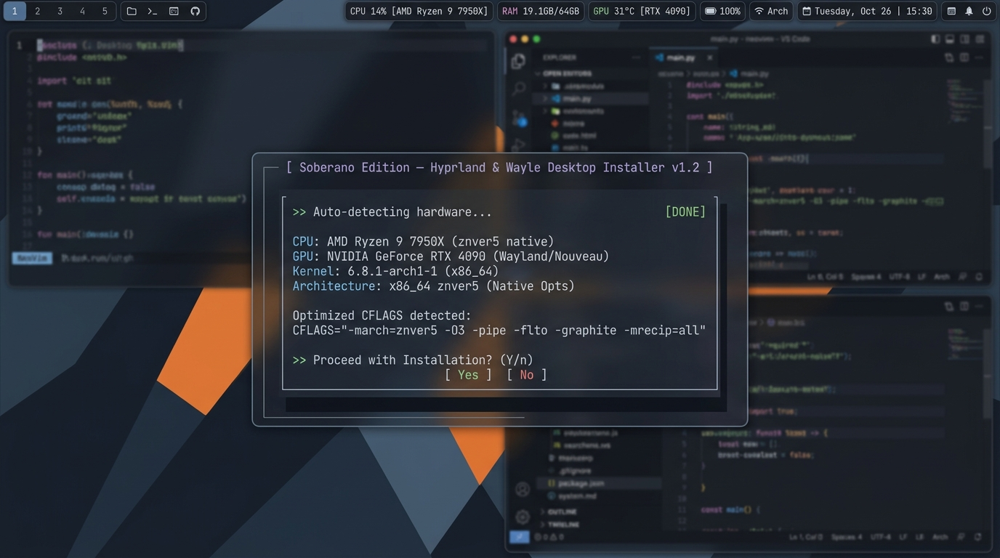
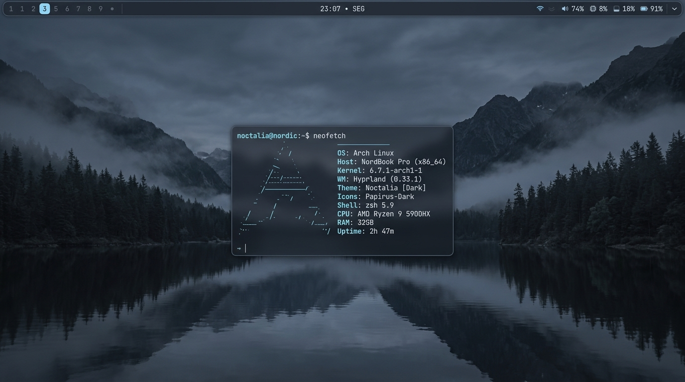
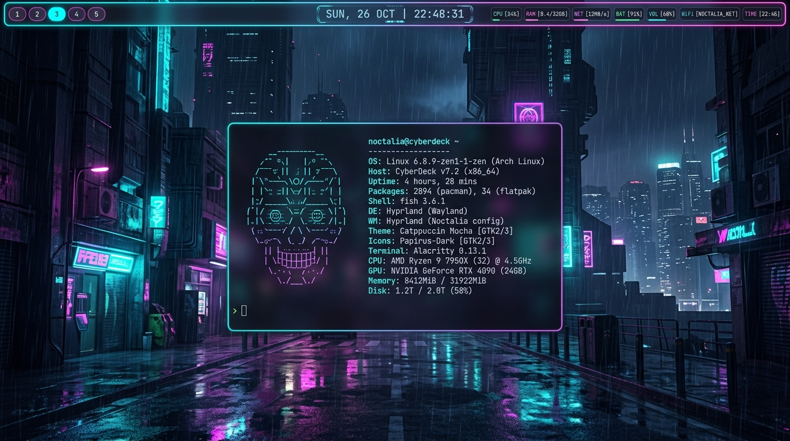
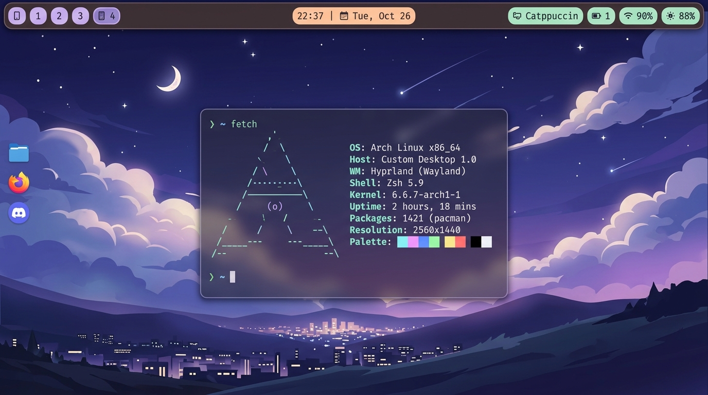
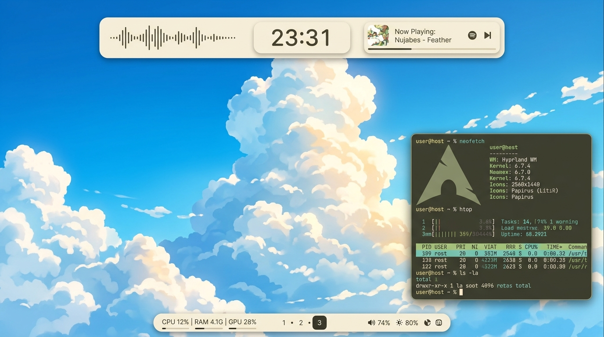

# Soberano Dotfiles

<p align="center">
  
</p>

Arquitetura enxuta, modular e de altíssimo desempenho para **Arch Linux** e **CachyOS**, construída do zero sobre **Hyprland (Lua Nativo)**, **Wayle Shell (`wayle-bin` em Rust/GTK4)**, **Matugen (Material Design 3)**, **Fuzzel** e **awww**.

---

## Galeria Visual & Presets

O Soberano Dotfiles foi desenvolvido com um motor de temas responsivo integrado ao Material Design 3. Ao trocar o papel de parede, todos os componentes do sistema (Barra Wayle, Hyprland, Kitty, Fuzzel, Btop e GTK) se adaptam harmonicamente em milissegundos.

| Nordic Slate (Foco & Código) | Cyberpunk Glow (Shaders & CAVA) |
| :---: | :---: |
|  |  |

| Catppuccin Velvet (Pastel Suave) | Japanese Minimalist (Estética Clean) |
| :---: | :---: |
|  |  |

> [!TIP]
> **Todos os temas acima vêm 100% integrados e prontos para uso no repositório!**
> Você pode alternar entre eles a qualquer momento pressionando **`Super + Shift + T`** ou rodando **`soberano-theme`** no terminal. O script aplica instantaneamente o papel de parede correspondente da coleção em `wallpapers/`, a geometria da barra do Wayle, o algoritmo de cores do Matugen e os shaders GLSL correspondentes.

---

## Destaques da Arquitetura

- **Instalador TUI Inteligente (Inspirado no Gentoo)**: Interface via `dialog` com alto contraste, autodetecção de hardware e validação sem quebras visuais.
- **Auto-Detecção de Hardware & Microarquitetura**:
  - Detecção precisa de GPUs (NVIDIA Híbrido, AMD Radeon iGPU/dGPU, Intel Iris/Xe, ou Máquinas Virtuais).
  - Leitura do ISA real da CPU (ex: `znver5`, `znver4`, `alderlake`, `skylake`) e extensões vetoriais (`AVX-512`, `AVX2`, `FMA`, `AES`, `SHA`).
  - Calibragem automática de `CFLAGS="-march=native -O3 -pipe -fno-plt"` e `MAKEFLAGS="-j$CORES"` em `/etc/makepkg.conf.d/` para que pacotes do AUR compilem com máxima performance de hardware.
  - Reconhecimento de chassi para ativação de gestos de touchpad em notebooks (`workspace_swipe`).
- **Sincronização Contínua & Auto-Atualização Git**:
  - Serviço e timer systemd (`soberano-autoupdate.timer`) para verificar e atualizar os dotfiles em segundo plano sem quebrar configs locais.
  - Notificações de desktop nativas (`notify-send`) informando novas revisões aplicadas.
  - Comando direto `soberano-update` no terminal.
- **Wayle Desktop Shell (Rust)**:
  - 10 presets visuais de barra alternáveis instantaneamente via `Super + Ctrl + B` (Floating Pill, Cyber Blade, Dynamic Island, macOS Dock, Audiophile Soundstage, etc.).
- **Material You Engine (Matugen)**:
  - Extração harmônica de cores em tempo real via algoritmo Material Design 3 (`Super + Alt + B`).
- **Shaders GLSL Hyprland**:
  - Filtros visuais de pós-processamento aplicados em tempo real na GPU (`Super + Alt + S`).

---

## ⚡ Por que Rust? A Superioridade do Wayle e dos Utilitários Soberano

O Soberano Dotfiles abandonou deliberadamente soluções obsoletas baseadas em JavaScript, GJS e Electron (como Noctalia, AGS ou shells web interpretados). Em seu lugar, adotamos uma arquitetura nativa focada em **desempenho determinístico, latência zero e consumo irrisório de memória**.

### 1. Wayle Shell (`wayle` em Rust puro)
- **Zero Garbage Collector (GC)**: Camadas web e runtimes JS sofrem com pausas estocásticas do coletor de lixo do V8/Spidermonkey, causando micro-stutters em monitores de alta taxa de atualização (144Hz–360Hz). O Wayle compila em código de máquina direto, mantendo frame pacing estável a 144+ FPS.
- **Pegada de Memória Mínima**: Enquanto barras em Electron/GJS consomem entre **300 MB e 800 MB de RAM** apenas em repouso, o Wayle opera de forma contínua consumindo apenas **~15 MB a 25 MB**.
- **Composição e IPC Direto**: Comunicação direta e assíncrona com os protocolos Wayland (`wlr-layer-shell`, `xdg-shell`), renderizador de áudio PipeWire e D-Bus sem intermediários lentos.

### 2. Utilitários Nativos Soberano (`tools/` em Rust + GTK4)
- **`wallpaper-picker-rs` (Super + W)**: Seletor de papéis de parede ultrarrápido com renderização assíncrona de miniaturas na GPU e extração instantânea via Matugen.
- **`display-picker-rs` (Super + M)**: Gerenciador gráfico de monitores, resoluções, taxas de atualização (Hz) e escala HiDPI. Utiliza `gtk4::WindowHandle` integrado à GPU do Hyprland, eliminando qualquer atraso de arrasto do cursor (movimentação 1:1 com latência zero).
- **Compilação Otimizada no Cliente (`target-cpu=native`)**: Durante a instalação via `install.sh`, as ferramentas são compiladas ou executadas especificamente para a microarquitetura da CPU do usuário (Zen 4/5, Raptor Lake, Arrow Lake) tirando proveito de instruções vetoriais como **AVX-512, AVX2 e FMA**.
- **Organização Modular em Branches Isoladas**: O código das ferramentas é mantido de forma limpa em branches separadas no repositório (`tools/display-picker` e `tools/wallpaper-picker`), facilitando auditorias, atualizações cirúrgicas e manutenção modular sem poluir a branch principal.

| Métrica | Tecnologias Obsoletas (Noctalia / AGS / Electron) | Arquitetura Soberano (Wayle + Rust Nativo) |
| :--- | :--- | :--- |
| **Linguagem & Runtime** | JavaScript / GJS / V8 Engine | **Rust (Código Nativo LLVM)** |
| **Uso de Memória RAM** | 350 MB – 850 MB | **~15 MB – 30 MB** (Redução de >95%) |
| **Latência de Entrada (Frame Drops)** | Alta (Pausas de GC e serialização JSON) | **Zero (Determinístico / Frame Pacing 144Hz+)** |
| **Arrasto de Janela & UI** | Atraso perceptível no ponteiro | **Hardware Accelerated via GPU (`WindowHandle`)** |
| **Otimização de Hardware** | Genérica (Bytecode interpretado) | **Nativa (`-C target-cpu=native`, AVX-512)** |
| **Estabilidade** | Crashes por runtime/node_modules | **Memory Safe, sem Null Pointers, Binários Estáticos** |

---

## Stack de Componentes

| Componente | Binário | Função Principal |
| :--- | :--- | :--- |
| **Compositor** | `Hyprland` (`hyprland.lua`) | Gerenciador de janelas Wayland configurado 100% em Lua nativo (`144Hz`, VRR, Direct Scanout) |
| **Desktop Shell** | `wayle` (`wayle-bin`) | Barra, Central de Notificações, OSD, CAVA, Áudio, Rede, Clima e Integração Nativa Matugen |
| **Motor de Cores** | `matugen` (`matugen-bin`) | Harmonização Material Design 3 sincronizando Wayle, Hyprland, Kitty, Fuzzel, Btop e GTK3/4 |
| **App Launcher** | `fuzzel` | Launcher Wayland ultraleve em C estilizado dinamicamente pelo Matugen |
| **Wallpaper Engine** | `awww` (`awww-daemon`) | Transições fluidas a 144 FPS controladas diretamente pelo Wayle (~2.7 MB RAM) |
| **Terminal & Monitor** | `kitty` + `btop` | Sincronizados em tempo real via templates Matugen |
| **Auto-Updater** | `soberano-update` | Sincronizador contínuo com repositório remoto via git e systemd timer |

---

## Como Instalar

### 1. Pré-Requisitos
O ecossistema foi desenvolvido nativamente para **Arch Linux**, **CachyOS** ou distribuições baseadas em Arch (EndeavourOS, Manjaro). Certifique-se de ter o `git` e a base de compilação instalados:

```bash
sudo pacman -S --needed git base-devel
```

### 2. Clonar o Repositório

```bash
git clone https://github.com/ViniciusPHDU20/soberano-dotfiles.git ~/dotfiles
cd ~/dotfiles
```

### 3. Modo de Simulação / Teste (Dry-Run Seguro)
Permite visualizar a interface TUI do instalador, inspecionar o diagnóstico automático de hardware da sua máquina (CPU SIMD, modelo da GPU e chassi) sem alterar nenhum pacote ou arquivo do sistema:

```bash
./install.sh --test
```

### 4. Instalação Definitiva
Executa a instalação completa com aceleração gráfica correta (NVIDIA, AMD Radeon, Intel ou VM), otimizações de compilação nativas (`target-cpu=native`), vínculo de dotfiles em `~/.config` e sanitização multi-usuário:

```bash
chmod +x install.sh
./install.sh
```

---

## Atualizações Automáticas (Clientes)

O instalador configura opcionalmente o **Soberano Auto-Updater**, mantendo a máquina do cliente sempre sincronizada com as novidades do repositório:

- **Automático via Systemd**: o timer `soberano-autoupdate.timer` executa a sincronização periódica silenciosamente. Quando você envia um commit no GitHub, a máquina do cliente baixa as novidades, recarrega o Hyprland ao vivo e envia uma notificação visual.
- **Manual via Terminal**: a qualquer momento, o usuário pode rodar:
  ```bash
  soberano-update
  ```

---

## Atalhos de Teclado Principais

| Atalho | Ação |
| :--- | :--- |
| `Super + Enter` | Abrir Terminal Kitty |
| `Super + Q` | Fechar Janela Focada |
| `Super + Shift + Q` | Forçar Finalização do Processo Ativo (`KillActiveProcess`) |
| `Super + Espaço` / `Super + D` | Lançador de Aplicativos (Fuzzel) |
| `Super + Shift + S` / `Print` | **Captura de Região com Swappy** *(Otimizado para teclados 60% e edição com setas/blur)* |
| `Super + Print` | Captura de Tela Inteira com Swappy |
| `Super + Shift + Print` | Cópia Instantânea de Área para o Clipboard (Sem editor) |
| `Super + W` | Galeria de Wallpapers GTK4 (Cinema Studio / Wallpaper Animator IA) |
| `Super + Shift + W` | Seletor de Wallpapers Animados (Steam Wallpaper Engine + Matugen) |
| `Super + Alt + W` | Wallpaper Aleatório com Transição + Matugen |
| `Super + Shift + T` | Seletor de Temas Oficiais (Nordic, Cyberpunk, Catppuccin, Zen) |
| `Super + Ctrl + B` | Seletor de Presets da Barra Wayle (10 layouts) |
| `Super + Alt + B` | Seletor de Esquemas de Cores Material You |
| `Super + Alt + S` | Alternar Shaders GLSL de Tela (Cyberpunk, CRT, etc.) |
| `Super + Alt + A` | Seletor de Perfis de Animação do Hyprland |
| `Super + V` | Histórico da Área de Transferência (`cliphist` + `fuzzel`) |
| `Super + G` / `Super + F1` | GameMode Competitivo (Clocks GPU Travados + CPU Performance + Zero Overhead) |
| `Super + Shift + P` / `Super + F2` | Menu de Perfis de Energia (Eco Silencioso, Balanceado, Computação, Game) |
| `Super + Shift + E` | Alternar Modo Eco Rápido (Menor Clock & TDP) |
| `Super + M` | Gerenciador de Monitores, Resolução & Taxa Hz (Nativo em Rust) |
| `Super + H` / `Super + K` / `Super + ?` | HUD Visual de Atalhos do Sistema (Soberano) |
| `Super + S` | Alternar Scratchpad Especial (Workspace Oculto) |
| `Super + Ctrl + S` | Mover Janela para o Scratchpad Especial |
| `Super + C` | Abrir Calculadora |
| `Super + E` | Abrir Gerenciador de Arquivos |
| `Super + B` | Abrir Navegador Web |
| `Super + L` | Bloquear Sessão |

---

## Perfis de Energia (CPU + GPU)

O motor `scripts/soberano-power-profile.sh` resolve o perfil pelo hardware real, não por uma lista fixa de modelos.

```bash
soberano-power-profile.sh --menu          # fuzzel (Super + F2 / Super + Shift + P)
soberano-power-profile.sh --eco           # piso de clock por núcleo + GPU fria
soberano-power-profile.sh --balanced      # clocks dinâmicos + GPU auto
soberano-power-profile.sh --compute       # teto por núcleo + GPU desbloqueada
soberano-power-profile.sh --toggle-eco    # Super + Shift + E
soberano-power-profile.sh --status
soberano-power-profile.sh --probe         # dump do hardware (driver, EPP, PL da GPU)
soberano-power-profile.sh --dry-run       # imprime cada escrita em sysfs, sem tocar em nada
```

**Política de governor por driver** — o nome `powersave` não significa a mesma coisa em todo lugar:

| Driver | eco | balanced | compute |
|---|---|---|---|
| `amd-pstate-epp` / `intel_pstate` | `powersave` + EPP `power` | `powersave` + EPP `balance_performance` | `performance` + EPP `performance` |
| `acpi-cpufreq` / `intel_cpufreq` | `powersave` (piso estático) | `schedutil` → `ondemand` → `conservative` | `performance` → `conservative` |

Em `acpi-cpufreq` o governor `powersave` é *frequência mínima fixa* — usá-lo em "balanced" travaria a máquina no clock mais baixo. O motor escolhe `schedutil` nesses casos.

**Tetos por núcleo** — cada núcleo recebe o seu próprio `cpuinfo_max_freq`, nunca o do `cpu0`. Em CPUs híbridas (Intel P+E), escrever o teto do P-core nos E-cores falha com `EINVAL` e deixaria os E-cores presos no clamp anterior até o reboot. O estado original é gravado em `$XDG_RUNTIME_DIR/soberano-power/cpu-limits/` e restaurado núcleo a núcleo.

O GameMode usa a mesma camada (`scripts/soberano-hw-lib.sh`) e, ao desligar, devolve o perfil que estava ativo embaixo dele — eco continua eco.

---

## Estrutura do Projeto

```text
soberano-dotfiles/
├── assets/
│   └── screenshots/        # Galeria ilustrativa do desktop
├── config/
│   ├── hypr/               # Configuração modular em Lua nativo (hyprland.lua)
│   ├── wayle/              # Configuração do Wayle Shell (schema 0.7.0) + presets
│   ├── matugen/            # Templates Material Design 3
│   ├── fuzzel/             # Launcher Wayland ultraleve
│   ├── kitty/              # Terminal acelerado por GPU
│   ├── btop/               # Monitor de recursos com tema dinâmico
│   ├── systemd/user/       # Units do timer de auto-atualização contínua
│   ├── fastfetch/
│   ├── fish/
│   └── quickshell/
├── scripts/
│   ├── soberano-update.sh        # Motor de sincronização contínua Git
│   ├── soberano-livewallpaper.sh # Motor de Live Wallpapers (Steam Wallpaper Engine + Matugen)
│   ├── soberano-hw-lib.sh        # Camada de hardware compartilhada (governor, EPP, tetos por núcleo, GPU)
│   ├── soberano-power-profile.sh # Perfis de energia eco / balanced / compute / game
│   ├── WallpaperSelect.sh        # Seletor de Wallpaper Estático + Matugen
│   ├── MatugenSchemeSelect.sh    # Seletor de Esquemas de Cores
│   ├── WayleBarPresetSelect.sh   # Seletor dos 10 Presets do Wayle
│   ├── HyprAnimationsSelector.sh # Perfis de física e animações
│   ├── GameMode.sh               # Modo de baixa latência para jogos
│   └── KeyBinds.sh               # HUD de atalhos interativo
├── wallpapers/             # Biblioteca curada de papéis de parede dinâmicos
└── install.sh              # Instalador TUI Gentoo-Style com autoprobing
```

---

<p align="center">
  <b>Soberano Dotfiles</b> • Arquitetura de Elite para Arch Linux & CachyOS
</p>
